<!-- GENERATED by spm_ultra/diagrams.py. Do not edit by hand: run `spm-ultra --write-diagrams`. -->

# 01. Cluster Topology

The command hierarchy: 1 Master Orchestrator, 6 directorate leads, 30 specialists.
Every specialist reports up through exactly one lead. The master never reads raw specialist output except through reconciliation (see [06](06-contradiction-audit.md)).

```mermaid
flowchart TB
    M(["Master Orchestrator"])
    L1{{"Lead D1: Strategic and Market Intelligence"}}
    M <--> L1
    subgraph D1["Directorate 1 (Agents 1-5)"]
        direction TB
        A01["A01 SWOT Matrix Specialist"]
        A02["A02 PESTLE Macro Analyst"]
        A03["A03 Porter's Five Forces Specialist"]
        A04["A04 Blue Ocean Strategist"]
        A05["A05 Trend and Horizon Forecaster"]
    end
    L1 <--> A01
    L1 <--> A02
    L1 <--> A03
    L1 <--> A04
    L1 <--> A05
    L2{{"Lead D2: Operational Roadmap and Target Mapping"}}
    M <--> L2
    subgraph D2["Directorate 2 (Agents 6-10)"]
        direction TB
        A06["A06 SMART Taxonomy Engine"]
        A07["A07 OKR Cascader"]
        A08["A08 Agile Sprint and WBS Architect"]
        A09["A09 Resource Allocation Modeler"]
        A10["A10 Change Management Planner"]
    end
    L2 <--> A06
    L2 <--> A07
    L2 <--> A08
    L2 <--> A09
    L2 <--> A10
    L3{{"Lead D3: Financial Feasibility and Economic Modeling"}}
    M <--> L3
    subgraph D3["Directorate 3 (Agents 11-15)"]
        direction TB
        A11["A11 CapEx Estimator"]
        A12["A12 OpEx Runway Modeler"]
        A13["A13 Break-Even and Yield Analyst"]
        A14["A14 Monetization Architect"]
        A15["A15 NPV and ROI Calculator"]
    end
    L3 <--> A11
    L3 <--> A12
    L3 <--> A13
    L3 <--> A14
    L3 <--> A15
    L4{{"Lead D4: Risk, Compliance and Adversarial Stress-Testing"}}
    M <--> L4
    subgraph D4["Directorate 4 (Agents 16-20)"]
        direction TB
        A16["A16 Project Pre-Mortem Lead"]
        A17["A17 Probability/Impact Matrix Specialist"]
        A18["A18 Regulatory and Compliance Watchdog"]
        A19["A19 Single Point of Failure Auditor"]
        A20["A20 Disaster Recovery and Continuity Planner"]
    end
    L4 <--> A16
    L4 <--> A17
    L4 <--> A18
    L4 <--> A19
    L4 <--> A20
    L5{{"Lead D5: Product, Tech Stack and Technical Architecture"}}
    M <--> L5
    subgraph D5["Directorate 5 (Agents 21-25)"]
        direction TB
        A21["A21 MVP Scope Rationalizer"]
        A22["A22 Architectural Dependency Mapper"]
        A23["A23 UX/User Journey Flow Auditor"]
        A24["A24 Scalability and Tech-Debt Estimator"]
        A25["A25 Procurement and Vendor Evaluator"]
    end
    L5 <--> A21
    L5 <--> A22
    L5 <--> A23
    L5 <--> A24
    L5 <--> A25
    L6{{"Lead D6: Commercialization and GTM Execution"}}
    M <--> L6
    subgraph D6["Directorate 6 (Agents 26-30)"]
        direction TB
        A26["A26 ICP and Persona Profiler"]
        A27["A27 GTM Channels Strategist"]
        A28["A28 Positioning and Messaging Architect"]
        A29["A29 CAC vs LTV Modeler"]
        A30["A30 Scale and Retention Strategist"]
    end
    L6 <--> A26
    L6 <--> A27
    L6 <--> A28
    L6 <--> A29
    L6 <--> A30
    classDef d1 fill:#4C78A8,stroke:#222,color:#fff
    classDef d2 fill:#F58518,stroke:#222,color:#fff
    classDef d3 fill:#54A24B,stroke:#222,color:#fff
    classDef d4 fill:#E45756,stroke:#222,color:#fff
    classDef d5 fill:#72B7B2,stroke:#222,color:#fff
    classDef d6 fill:#B279A2,stroke:#222,color:#fff
    class A01,A02,A03,A04,A05 d1
    class A06,A07,A08,A09,A10 d2
    class A11,A12,A13,A14,A15 d3
    class A16,A17,A18,A19,A20 d4
    class A21,A22,A23,A24,A25 d5
    class A26,A27,A28,A29,A30 d6
```

| Directorate | Lead | Agents | Blueprint section |
|---|---|---|---|
| D1 | Lead D1 | A01, A02, A03, A04, A05 | Section I: Strategic Position & Market Forces |
| D2 | Lead D2 | A06, A07, A08, A09, A10 | Section II: Operational Milestones & Tracking Roadmap |
| D3 | Lead D3 | A11, A12, A13, A14, A15 | Section III: Structural Financial Projections & Runway |
| D4 | Lead D4 | A16, A17, A18, A19, A20 | Section IV: Defensibility, Compliance, & Risk Matrix |
| D5 | Lead D5 | A21, A22, A23, A24, A25 | Section V: Architectural Stability & Product Scope |
| D6 | Lead D6 | A26, A27, A28, A29, A30 | Section VI: Commercialization & GTM Channels |
