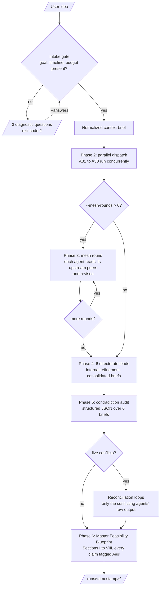

<!-- GENERATED by spm_ultra/diagrams.py. Do not edit by hand: run `spm-ultra --write-diagrams`. -->

# 02. Run Lifecycle

## Call budget per run

| Phase | Calls | Parallel | Effort flag |
|---|---|---|---|
| 1 Intake | 1 | no | medium (fixed) |
| 2 Dispatch | 30 | yes | `--worker-effort` |
| 3 Mesh round | 30 per round | yes | `--worker-effort` |
| 4 Leads | 6 | yes | `--lead-effort` |
| 5 Audit | 1 | no | `--master-effort` |
| 5 Reconcile | 0 to 5+ | yes | `--lead-effort` |
| 6 Blueprint | 1 | no | `--master-effort` |

Default total: about 40 calls. With `--mesh-rounds 1`: about 70.
Each phase waits for the previous phase to finish, so wall time is about 4 to 5 sequential steps, not 40.
