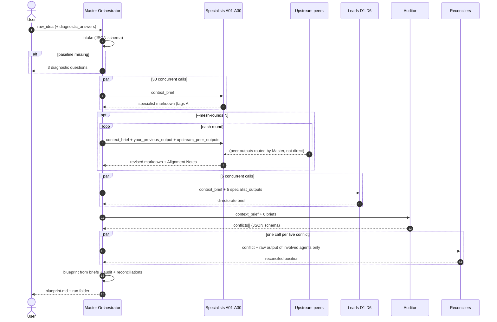

<!-- GENERATED by spm_ultra/diagrams.py. Do not edit by hand: run `spm-ultra --write-diagrams`. -->

# 03. Communication Protocol

Agents never call each other directly. Every message is routed by the Master Orchestrator, which decides what each node is allowed to see. This is how the cluster avoids token bloat and directive conflicts.

## Message envelopes

| # | Sender | Receiver | Envelope (XML tags in the user turn) | Format |
|---|---|---|---|---|
| 1 | User | Intake | `<raw_idea>`, `<diagnostic_answers>` | text |
| 2 | Intake | Master | `ready`, `context_brief`, `diagnostic_questions` | JSON schema |
| 3 | Master | Specialist | `<context_brief>` | text |
| 4 | Specialist | Master | `### A##: Name` + Findings, Assumptions, Recommendations, Cross-Dependencies, References | markdown |
| 5 | Master | Specialist (mesh) | `<context_brief>`, `<your_previous_output>`, `<upstream_peer_outputs><peer tag="A##">` | text |
| 6 | Master | Lead | `<context_brief>`, `<specialist_outputs><agent id name>` | text |
| 7 | Lead | Master | Directorate brief with Key Numbers table | markdown |
| 8 | Master | Auditor | `<context_brief>`, `<brief directorate="N">` x6 | text |
| 9 | Auditor | Master | `conflicts[]`: check, agent_ids, in_conflict, severity, description | JSON schema |
| 10 | Master | Reconciler | `<conflict>`, `<agent id name>` for involved agents only | text |
| 11 | Master | Blueprint | briefs, `<audit>`, `<reconciliations>` | text |

## Visibility rules

| Node | Sees | Never sees |
|---|---|---|
| Specialist (pass 1) | context brief | any other agent |
| Specialist (mesh) | context brief, own output, its upstream peers only | non upstream agents |
| Lead | its 5 specialists | other directorates |
| Auditor | 6 briefs | raw specialist output |
| Reconciler | raw output of the conflicting agents | everything else |
| Blueprint | briefs, audit, reconciliations | raw specialist output |

## Referencing convention

Every agent has a tag `A01` to `A30`. Agents must cite peers as `[A12]`, and the blueprint must tag every material claim with its source agents, e.g. `[A06, A12]`. This makes any number in the blueprint traceable back to `runs/<ts>/agents/agent_12.md`.
