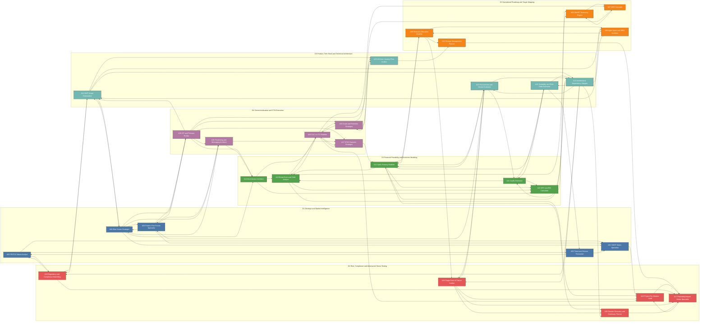
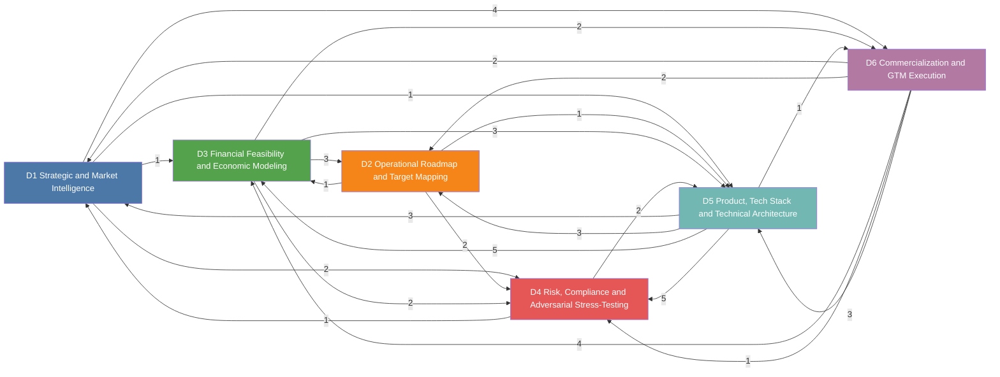

<!-- GENERATED by spm_ultra/diagrams.py. Do not edit by hand: run `spm-ultra --write-diagrams`. -->

# 04. Agent Mesh Network

The hierarchy in [01](01-cluster-topology.md) is the command path. This page is the **information mesh**: which specialist must read and align with which other specialist. An arrow `A12 --> A13` means A13 consumes A12's output.

The mesh is used in three places:
1. Every specialist's system prompt lists its upstream and downstream peers, so it states exactly what it needs and what it supplies.
2. With `--mesh-rounds N`, each specialist re-reads its upstream peers' actual output and revises (see [03](03-communication-protocol.md)).
3. Leads and the auditor use the `[A##]` cross-dependency tags to find contradictions.

**Stats:** 30 nodes, 95 directed edges (41 within a directorate, 54 across directorates). A literal full mesh would be 870 directed edges; the cluster deliberately wires only the dependencies that carry real numbers or decisions.

## Full agent mesh

## Directorate level mesh (edge label = number of agent links)

## Adjacency matrix

Row = producer, column = consumer. `●` means the column agent reads the row agent.

| from \ to | 01 | 02 | 03 | 04 | 05 | 06 | 07 | 08 | 09 | 10 | 11 | 12 | 13 | 14 | 15 | 16 | 17 | 18 | 19 | 20 | 21 | 22 | 23 | 24 | 25 | 26 | 27 | 28 | 29 | 30 |
|---|---|---|---|---|---|---|---|---|---|---|---|---|---|---|---|---|---|---|---|---|---|---|---|---|---|---|---|---|---|---|
| **A01** |  |  |  |  |  |  |  |  |  |  |  |  |  |  |  | ● |  |  |  |  |  |  |  |  |  |  |  |  |  |  |
| **A02** | ● |  |  |  | ● |  |  |  |  |  |  |  |  |  |  |  |  | ● |  |  |  |  |  |  |  |  |  |  |  |  |
| **A03** | ● |  |  | ● |  |  |  |  |  |  |  |  |  |  |  |  |  |  |  |  |  |  |  |  |  | ● |  | ● |  |  |
| **A04** | ● |  | ● |  |  |  |  |  |  |  |  |  |  | ● |  |  |  |  |  |  | ● |  |  |  |  | ● |  | ● |  |  |
| **A05** | ● | ● |  |  |  |  |  |  |  |  |  |  |  |  |  |  |  |  |  |  |  |  |  |  |  |  |  |  |  |  |
| **A06** |  |  |  |  |  |  | ● |  |  |  |  |  |  |  |  |  |  |  |  |  |  |  |  |  |  |  |  |  |  |  |
| **A07** |  |  |  |  |  | ● |  |  |  |  |  |  |  |  |  |  |  |  |  |  |  |  |  |  |  |  |  |  |  |  |
| **A08** |  |  |  |  |  |  |  |  | ● |  |  |  |  |  |  |  |  |  |  |  | ● |  |  |  |  |  |  |  |  |  |
| **A09** |  |  |  |  |  |  |  | ● |  | ● |  | ● |  |  |  |  |  |  | ● |  |  |  |  |  |  |  |  |  |  |  |
| **A10** |  |  |  |  |  |  |  |  |  |  |  |  |  |  |  |  | ● |  |  |  |  |  |  |  |  |  |  |  |  |  |
| **A11** |  |  |  |  |  |  |  |  |  |  |  |  | ● |  | ● |  |  |  |  |  |  |  |  | ● |  |  |  |  |  |  |
| **A12** |  |  |  |  |  |  |  |  | ● |  |  |  | ● |  | ● |  |  |  |  | ● |  |  |  | ● | ● |  |  |  |  |  |
| **A13** |  |  |  |  |  | ● |  |  |  |  |  |  |  |  | ● | ● |  |  |  |  |  |  |  |  |  |  |  |  | ● |  |
| **A14** |  |  |  |  |  |  |  |  |  |  |  |  | ● |  | ● |  |  |  |  |  |  |  |  |  |  |  |  |  | ● |  |
| **A15** |  |  |  |  |  | ● |  |  |  |  |  |  |  |  |  |  |  |  |  |  |  |  |  |  |  |  |  |  |  |  |
| **A16** |  |  |  |  |  |  |  |  |  |  |  |  |  |  |  |  | ● |  |  |  |  |  |  |  |  |  |  |  |  |  |
| **A17** |  |  |  |  |  |  |  |  |  |  |  |  |  |  |  | ● |  |  |  |  |  |  |  |  |  |  |  |  |  |  |
| **A18** |  | ● |  |  |  |  |  |  |  |  |  |  |  |  |  |  | ● |  |  |  | ● |  |  |  |  |  |  |  |  |  |
| **A19** |  |  |  |  |  |  |  |  |  |  |  |  |  |  |  | ● | ● |  |  | ● |  |  |  |  | ● |  |  |  |  |  |
| **A20** |  |  |  |  |  |  |  |  |  |  |  |  |  |  |  |  | ● |  |  |  |  |  |  |  |  |  |  |  |  |  |
| **A21** |  |  |  | ● |  |  |  | ● |  |  |  |  |  |  |  |  |  | ● |  |  |  | ● | ● |  |  |  |  |  |  |  |
| **A22** |  |  |  |  |  |  |  | ● |  |  | ● | ● |  |  |  |  |  | ● | ● | ● |  |  |  | ● | ● |  |  |  |  |  |
| **A23** |  |  |  |  |  |  |  |  |  | ● |  |  |  |  |  |  |  |  |  |  |  |  |  |  |  |  |  |  |  | ● |
| **A24** |  |  |  |  | ● |  |  |  |  |  | ● |  |  |  |  |  |  |  |  |  |  | ● |  |  |  |  |  |  |  |  |
| **A25** |  |  | ● |  |  |  |  |  |  |  | ● | ● |  |  |  |  |  |  | ● |  |  | ● |  |  |  |  |  |  |  |  |
| **A26** |  |  | ● |  |  |  |  |  |  |  |  |  |  | ● |  |  |  |  |  |  | ● |  | ● |  |  |  | ● | ● |  | ● |
| **A27** |  |  |  |  |  |  |  |  |  |  |  | ● |  |  |  |  |  |  |  |  |  |  |  |  |  |  |  |  | ● |  |
| **A28** |  |  |  | ● |  |  |  |  |  |  |  |  |  | ● |  |  |  |  |  |  |  |  |  |  |  |  | ● |  |  |  |
| **A29** |  |  |  |  |  |  | ● |  |  |  |  |  | ● |  |  | ● |  |  |  |  |  |  |  |  |  |  | ● |  |  | ● |
| **A30** |  |  |  |  |  |  | ● |  |  |  |  |  |  |  |  |  |  |  |  |  |  |  | ● |  |  |  |  |  | ● |  |
