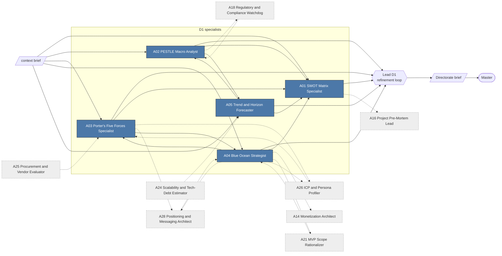
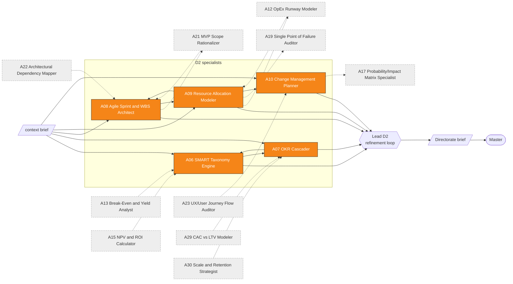
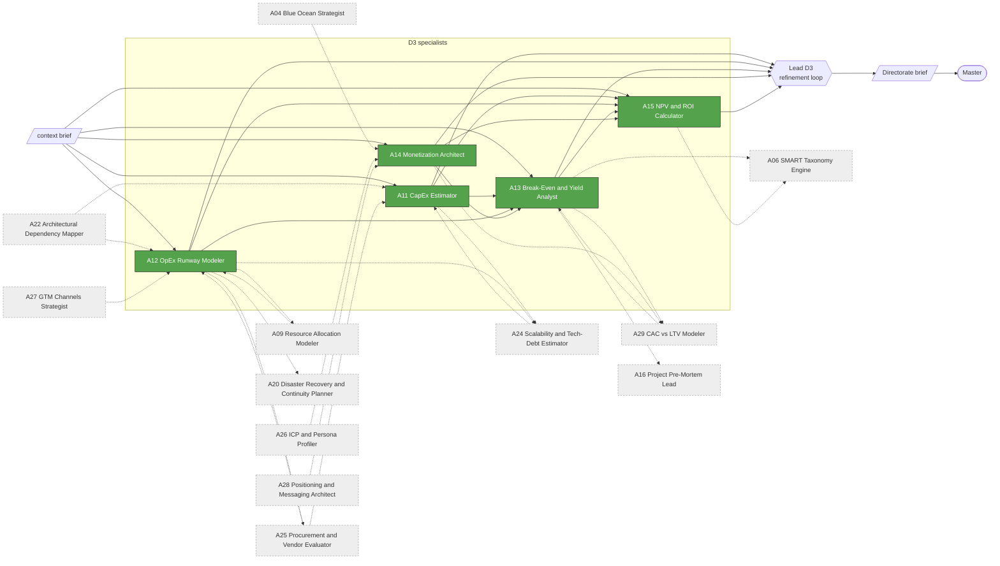
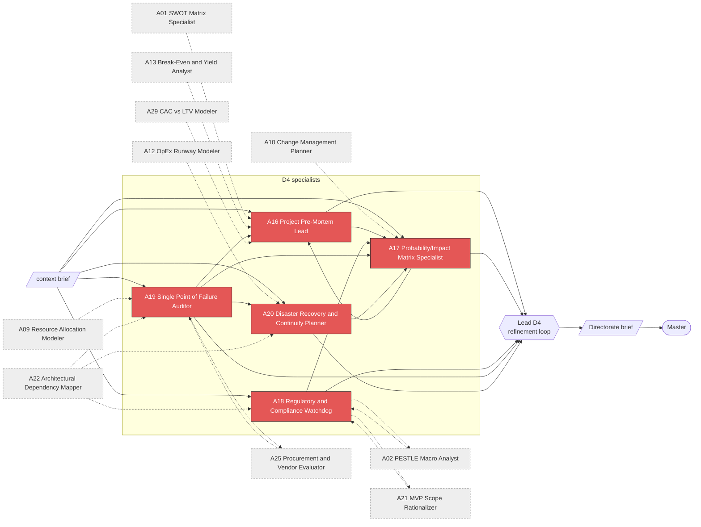
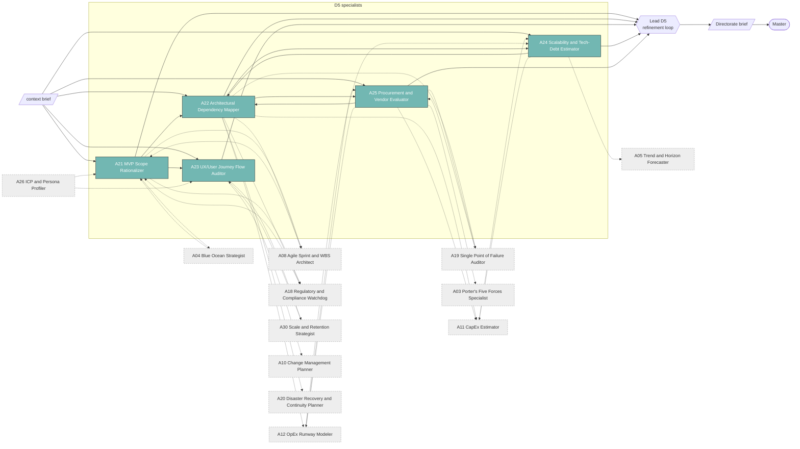
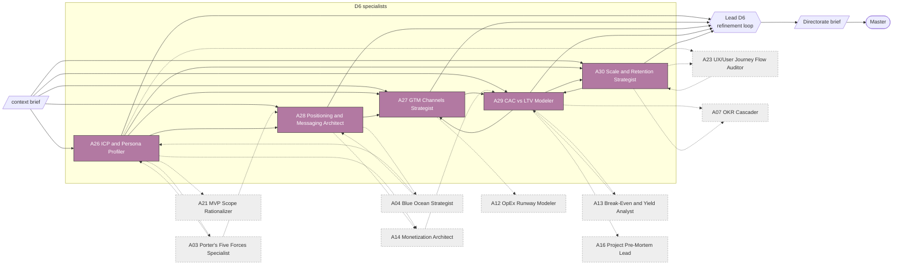

<!-- GENERATED by spm_ultra/diagrams.py. Do not edit by hand: run `spm-ultra --write-diagrams`. -->

# 05. Directorate Internal Flows

Each directorate runs its 5 specialists in parallel, optionally revises them through the mesh, then its lead runs the internal refinement loop. Dotted nodes are peers in other directorates.

## D1: Strategic & Market Intelligence (Agents 1-5)

Output feeds **Section I: Strategic Position & Market Forces**.

## D2: Operational Roadmap & Target Mapping (Agents 6-10)

Output feeds **Section II: Operational Milestones & Tracking Roadmap**.

## D3: Financial Feasibility & Economic Modeling (Agents 11-15)

Output feeds **Section III: Structural Financial Projections & Runway**.

## D4: Risk, Compliance & Adversarial Stress-Testing (Agents 16-20)

Output feeds **Section IV: Defensibility, Compliance, & Risk Matrix**.

## D5: Product, Tech Stack & Technical Architecture (Agents 21-25)

Output feeds **Section V: Architectural Stability & Product Scope**.

## D6: Commercialization & GTM Execution (Agents 26-30)

Output feeds **Section VI: Commercialization & GTM Channels**.

