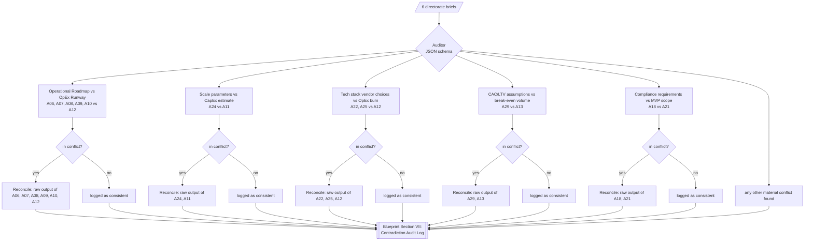

<!-- GENERATED by spm_ultra/diagrams.py. Do not edit by hand: run `spm-ultra --write-diagrams`. -->

# 06. Contradiction Audit and Reconciliation

The auditor always evaluates the mandatory cross checks below, and reports any other material conflict it finds. Each live conflict spawns one reconciliation call, which receives the **raw** output of only the agents involved. Reconciled figures override the directorate briefs in the final blueprint.

| # | Check | Side A | Side B |
|---|---|---|---|
| 1 | Operational Roadmap vs OpEx Runway | A06, A07, A08, A09, A10 | A12 |
| 2 | Scale parameters vs CapEx estimate | A24 | A11 |
| 3 | Tech stack vendor choices vs OpEx burn | A22, A25 | A12 |
| 4 | CAC/LTV assumptions vs break-even volume | A29 | A13 |
| 5 | Compliance requirements vs MVP scope | A18 | A21 |

Add checks in `MANDATORY_CROSS_CHECKS` in `spm_ultra/registry.py`, then regenerate.
